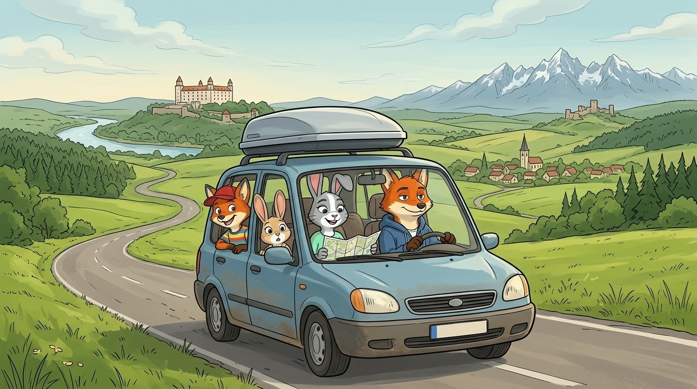
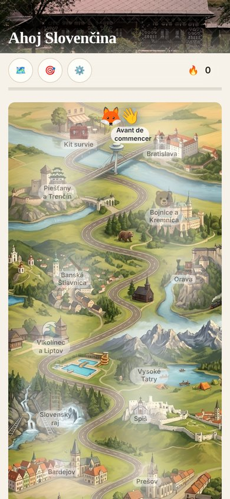
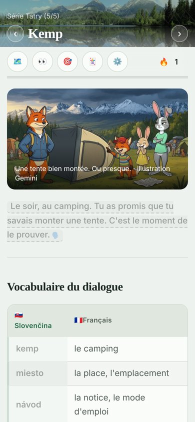
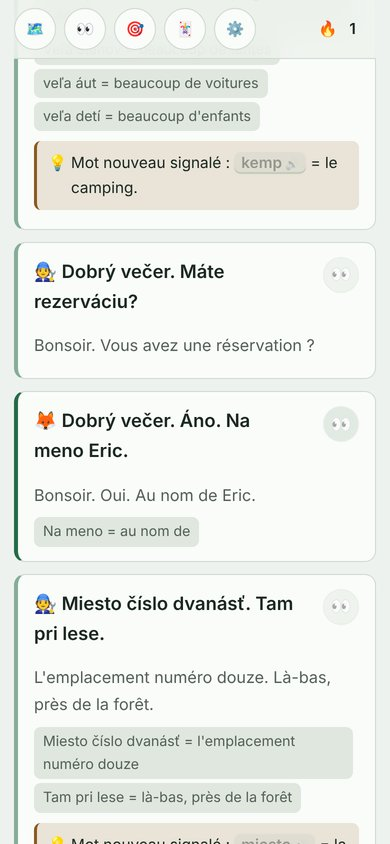
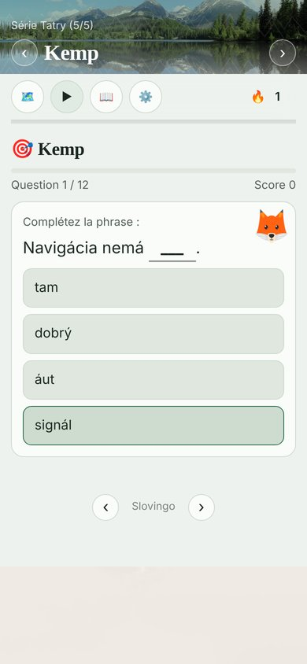

# Ahoj Slovenčina! Zo západu na východ 🇸🇰 🇫🇷

🌐 **Le cours en ligne : [lstux.github.io/Slovingo-sk-fr](https://lstux.github.io/Slovingo-sk-fr/)**

Un cours de slovaque pour les francophones. Et cette fois, on apprend en voyageant ! :)

## Le voyage

Tu es un renard français. Cet été, ta grande sœur te confie ses deux enfants, Hugo et Lola, et tu les emmènes en vacances en Slovaquie. En voiture, de Bratislava à Košice. Heureusement, ton amie Andrea vient avec vous : elle est née à Prešov, elle connaît tout le pays… et elle a un souvenir à chaque virage.

Douze jours, douze chapitres, et à peu près tout ce qu'il faut voir en Slovaquie : les châteaux de Trenčín, Bojnice, Orava et Spiš, Banská Štiavnica, Vlkolínec, les Tatras, le Slovenský raj, Levoča, Bardejov, Prešov, Košice… Plus quelques coins que seuls les gens du coin connaissent, parce qu'Andrea ne peut pas s'en empêcher.

Le tout avec des gags de vacances que tous les parents reconnaîtront : le GPS qui recalcule, la pension où quelqu'un ronfle, la tente montée à l'envers, et « on est arrivés ? » toutes les dix minutes. Pas d'intrigue compliquée, juste de bonnes vacances ! ^^

Et oui, il vouvoie encore Andrea de temps en temps. C'est un vieux jeu entre eux. Promis, ça s'explique.

## Aperçu

  
  
  
  

## Comment ça marche

- **Avant de partir** : une petite intro (le voyage, le pays, la langue, la prononciation) et un kit de survie pour dire bonjour, merci et pardon.
- **Une série = une journée de voyage.** Les fiches 1 à 4 donnent les mots et la grammaire du jour avec de petits dialogues, la fiche 5 raconte l'épisode, la fiche 6 la suite avec tout le vocabulaire de la série.
- **Tout s'écoute** : on touche une phrase et elle est lue, en slovaque comme en français. Le bouton 👀 donne la traduction, puis le détail mot par mot.
- **Des exercices** pour chaque fiche, et une carte de la Slovaquie en page d'accueil, qui s'éclaire au fil des étapes. Rien n'est jamais verrouillé.
- **Niveau** : on part de zéro, et on vise un bon A2 à la fin, en route vers le B1.
- **Pour aller plus loin** : du vocabulaire par thème, des annexes de grammaire et de conjugaison, et les séries **Kronika**, sur l'histoire de la Slovaquie.

## Les cousins

Le cours a deux petits frères, dans le même univers du renard et de la hase :

- 🧒 **[Slovingo-sk-fr-kids](https://github.com/lstux/Slovingo-sk-fr-kids)** : pour les enfants de 8 à 12 ans, des vacances dans les Tatras.
- 🎒 **[Slovingo-sk-fr-friends](https://github.com/lstux/Slovingo-sk-fr-friends)** : pour les ados, une vraie histoire de Košice à Bratislava.

Ici, c'est la version des grands : un univers parallèle, quelques années plus tard… mais Gab et Andrea se connaissent toujours depuis l'enfance. ;)

## Pourquoi ce cours ?

Au départ, je voulais juste apprendre le slovaque, découvrir un peu mieux un pays et une culture que je connaissais mal, et me lancer un petit défi. Et puis l'appli a grandi, les cours aussi… et me voilà avec un renard, une hase et deux gamins sur les routes de Slovaquie ! :D

Si ça peut donner à quelqu'un l'envie d'apprendre quelques mots de slovaque, de visiter le pays ou juste de faire de belles rencontres, c'est gagné.

## C'est une bêta !

Le cours est complet, mais il reste des choses à polir :

- **Le slovaque des dialogues est à faire relire par des natifs.** Surtout le dialecte de Prešov de babka Zuzana ! Si tu parles slovaque et que quelque chose sonne bizarre, n'hésite pas à ouvrir une issue, ça m'aidera beaucoup. Tout est expliqué dans 👉 [**Tu relis le slovaque ?**](docs/Relire-le-slovaque.md)
- Les crédits de certaines photos sont encore à compléter.
- Les chapitres 5 à 12 seront un peu étoffés.

Les remarques, corrections et idées sont les bienvenues ! :)

## Crédits

- **Photos** : [Wikimedia Commons](https://commons.wikimedia.org/), avec les auteurs et licences dans [`img/credits.md`](img/credits.md).
- **Illustrations** : générées avec Google Gemini, à partir de mes personnages et de photos des vrais lieux (détails et prompts dans [`docs/Prompts-illustrations.md`](docs/Prompts-illustrations.md)).
- **Moteur** : le cours tourne sur [Slovingo](https://github.com/lstux/Slovingo), mon petit framework pour apprendre les langues.

L'ancien cours adulte, avant le roadtrip, est gardé pour mémoire dans la branche [`original`](https://github.com/lstux/Slovingo-sk-fr/tree/original).

## Pour les curieux : le dépôt

- `md/` : les fiches, au format Slovingo Markdown.
- `exercises/` : les exercices écrits à la main.
- `img/` : les photos, les illustrations et leurs crédits.
- `docs/` : le concept du cours, le format des fiches, la progression, l'histoire complète en slovaque.
- `lang.json` : la configuration du cours (séries, thèmes, carte d'accueil).

**Déploiement** : à chaque push sur `main`, le workflow `.github/workflows/pages.yml` construit le site avec [Slovingo](https://github.com/lstux/Slovingo) et le publie sur **https://lstux.github.io/Slovingo-sk-fr/**. L'`url_path` est adapté au moment du build, sans modifier `lang.json` dans le repo. Le workflow `build-release.yml` (release en tarball, à lancer à la main) est toujours là.

---

*Slovingo est libre et open-source, sous licence [GPL-3.0](./LICENSE).*
